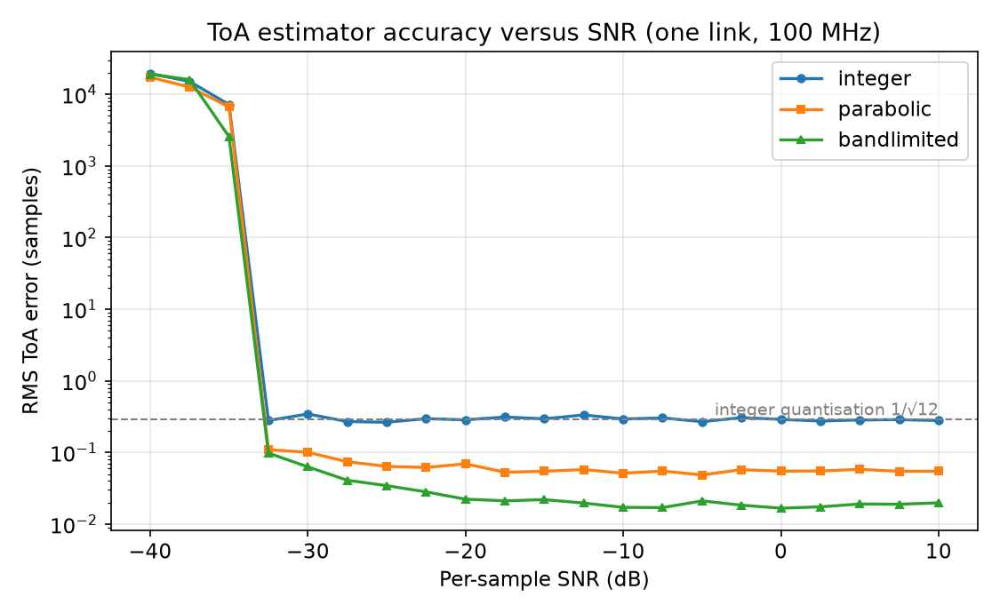
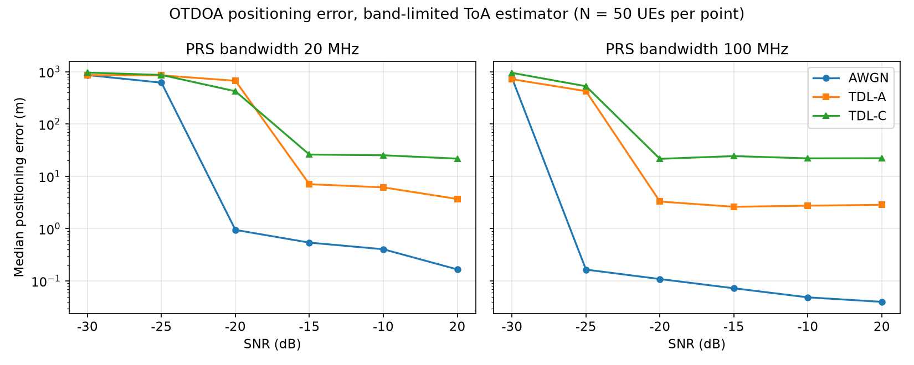
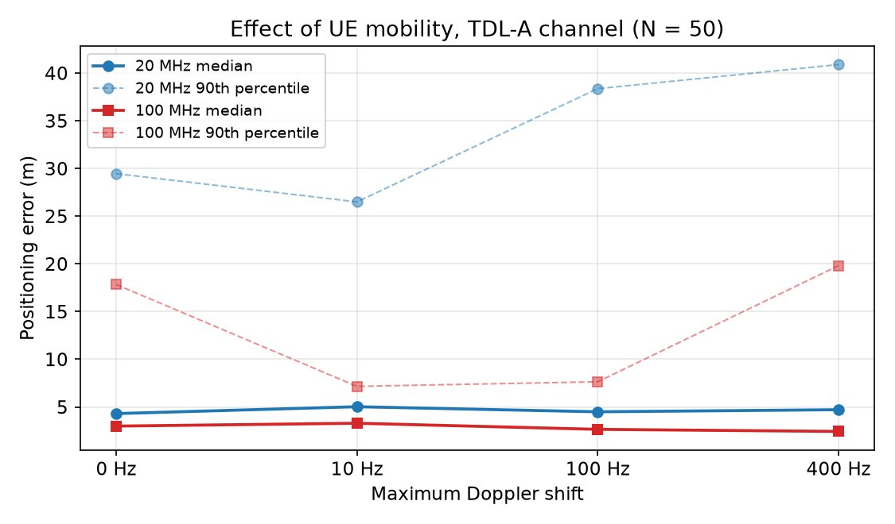

# OTDOA Positioning in 5G NR

EE 666 course project, IIT Gandhinagar (2026).
Authors: **Vishrut Sharma** and **Vikash Kumar Sinha**.

A MATLAB study of **observed time difference of arrival (OTDOA)** positioning with 5G NR positioning
reference signals (PRS): how accurately a UE can be located from the arrival-time differences of four
base stations, and how that accuracy depends on PRS bandwidth, SNR, multipath and UE mobility.

## What the code does

1. **Geometry:** four gNBs at the corners of a 1 km × 1 km area; geometric dilution of precision (GDOP)
   from the TDoA noise covariance, and the Cramér-Rao lower bound for ToA in terms of PRS bandwidth and SNR.
2. **Signals:** PRS waveforms generated with the 5G Toolbox for two configurations, **20 MHz** and
   **100 MHz**, with a staggered comb offset per gNB; each link applies the exact (fractional) geometric
   delay, noise, and optionally a 3GPP **TDL-A** or **TDL-C** fading channel with Doppler.
3. **Time of arrival:** cross-correlation with the known PRS, with three peak estimators —
   `integer` (argmax), `parabolic` (3-point fit) and `bandlimited` (FFT interpolation of the complex correlation).
4. **Position:** bounded non-linear least squares on the TDoA equations, with outage reporting.
5. **Monte Carlo:** random UE positions over the area for every bandwidth × channel × SNR combination,
   and a Doppler sweep (0, 10, 100, 400 Hz).

## Results

The figures below are drawn from the saved results file by `make_figures.py`.
**The saved run uses N = 50 UEs per point** (the `quick` preset); medians are stable at that size,
90th percentiles are not.

### ToA estimators

Above the acquisition threshold, the integer estimator is stuck at the quantisation floor
(1/√12 ≈ 0.289 samples ≈ 0.71 m at 100 MHz), parabolic interpolation reaches ≈ 0.055 samples (≈ 13 cm),
and band-limited interpolation ≈ 0.018 samples (≈ 4 cm).

### Positioning error

- **AWGN:** with the band-limited estimator the median error at 100 MHz falls to **0.04 m** (20 dB SNR), about
  **17×** better than the 0.71 m floor of integer-sample estimation.
- **Multipath:** under TDL-C the median error stays at **22–26 m** from −15 dB upwards, at both 20 MHz and
  100 MHz. It is a first-path selection bias (the strongest correlation peak is not the earliest
  path), so the remedy is first-arrival / leading-edge detection, not more SNR.

### UE mobility

Median error under TDL-A barely changes from 0 to 400 Hz Doppler (≈ 4–5 m at 20 MHz, ≈ 2.4–3.3 m at 100 MHz).

## Revisions

`EE666_v1_original_backup.m` is the version submitted with the report; `EE666_final_report_Vishrut_Vikash.m`
is revision 2. Its header explains every change. In short, v1's Monte Carlo results were flat across SNR
because:

1. the geometric delay was rounded to whole samples, and the ToA was the integer correlation peak, so the
   error was dominated by quantisation (0.289 samples) rather than noise;
2. the SNR sweep (0, 10, 20 dB) sat far above the point where noise matters, because the PRS correlation
   provides large processing gain;
3. `nrTDLChannel` was created with its default fixed seed, so every gNB, trial and run saw the **same**
   fading realisation — which made the multipath results look far better than they are.

Revision 2 applies fractional delays, adds the sub-sample estimators, moves the SNR sweep to −30…−10 dB
(keeping 20 dB as an anchor), randomises the fading per link, and staggers the PRS comb offsets.

## Files

| File | What |
| --- | --- |
| `EE666_final_report_Vishrut_Vikash.m` | Revision 2 (main script) |
| `EE666_v1_original_backup.m` | Original revision 1 |
| `EE666_report.pdf` | Project report (describes revision 1) |
| `EE666_results_N50.mat` | Saved Monte Carlo results (N = 50) |
| `make_figures.py` | Draws the README figures from the `.mat` file |
| `images/` | README figures |

## Running

MATLAB with the **5G Toolbox** (and Signal Processing / Communications toolboxes). Set `PRESET` at the
top of the script: `'quick'` (N = 50), `'standard'` (N = 300, default) or `'full'` (N = 1000). The larger
presets need several GB of free memory. The script saves its results as `EE666_results_v2.mat`.

To redraw the figures from the saved file: `python make_figures.py` (needs numpy, scipy, matplotlib).

## Notes

- The report PDF describes revision 1; the numbers above come from revision 2.
- The CRLB curve in the script is plotted against per-sample SNR, so it is not directly comparable with
  the Monte Carlo medians, which benefit from the PRS processing gain.
